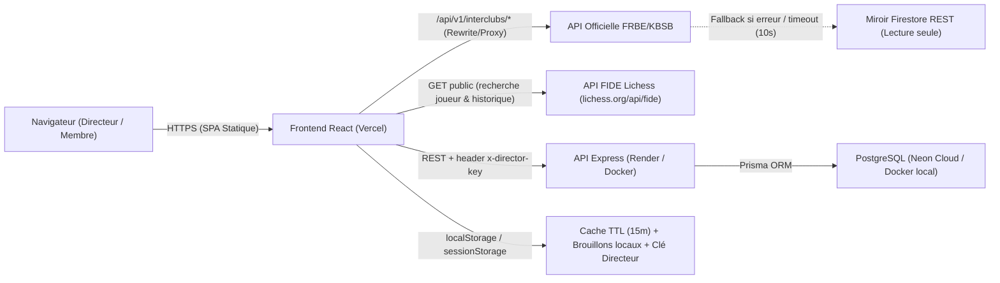

# Architecture Technique & Analyse Critique — Interclub Director Dashboard

Ce document présente les choix techniques globaux du projet **Interclub Director Dashboard**, explique comment s'articulent le frontend, le backend et les API externes (FRBE, Firestore, Lichess/FIDE), et propose une **analyse critique** assortie de pistes d'amélioration concrètes.

Les décisions structurantes détaillées sont formalisées dans le dossier [`docs/adr/`](./adr/README.md).

---

## 1. Vue d'ensemble de l'architecture

Le projet est organisé en **monorepo léger** (sans outil de workspace complexe comme Turborepo ou Nx) piloté depuis le `package.json` racine :

```text
interclub-dashboard/
├── interclub-dashboard/   # Frontend SPA (React 19 + TypeScript + Vite 8 + Tailwind v4)
├── server/                # Backend API REST (Express + Prisma + PostgreSQL)
├── docs/                  # Documentation technique et ADR
├── docker-compose.yml     # Stack locale Postgres 16 + API Express
└── DEPLOYMENT.md          # Procédure de déploiement gratuit (Vercel + Render + Neon)
```

### Schéma des flux de données



---

## 2. Synthèse des choix techniques (Stack)

| Couche | Choix retenu | Fichiers clés | Alternative écartée |
| :--- | :--- | :--- | :--- |
| **Frontend UI** | React 19, TypeScript (`~6.0.2`), Vite 8, Tailwind CSS v4, `lucide-react` | `interclub-dashboard/package.json` | Next.js (SSR inutile ici), MUI/Chakra |
| **Gestion d'état** | `React Context` (`ClubContext`, `SimulatorContext`) + `useClubData` | `src/context/`, `src/hooks/useClubData.ts` | Redux Toolkit, Zustand, TanStack Query |
| **Proxy & Sources externes** | Rewrites Vercel (`vercel.json`) + Proxy Vite (`vite.config.ts`) + Fallback Firestore REST | `src/api/frbeClient.ts`, `src/api/firestoreFallback.ts` | BFF complet côté serveur, SDK Firebase |
| **Données FIDE** | Client REST direct vers `lichess.org/api/fide` avec matching flou (Levenshtein) | `src/api/fideClient.ts` | Scraping FIDE ou base locale |
| **Backend API** | Express 4 (`^4.21.0`), TypeScript 5, Prisma 5, PostgreSQL | `server/src/index.ts`, `server/prisma/schema.prisma` | Firebase/Supabase BaaS, NestJS |
| **Authentification** | Clé secrète partagée (`DIRECTOR_KEY` / header `x-director-key`) | `server/src/middleware/auth.ts` | OAuth/JWT multi-utilisateurs |
| **Règles métier** | Calculs TPR, classements, scouting, validation FRBE 100 % côté client | `src/domain/`, `src/domain/rules/frbeValidator.ts` | Moteur de règles côté serveur |
| **Feuilles de match PDF** | HTML/CSS `@media print` isolé via `ReactDOM.createPortal` | `src/components/simulator/MatchSheetModal.tsx` | `jsPDF`, `pdfmake`, `@react-pdf/renderer` |
| **Qualité / Linting** | `oxlint` + compilation `tsc -b` | `interclub-dashboard/.oxlintrc.json` | ESLint + Vitest/Playwright |

---

## 3. Ce qui fonctionne bien (Points forts)

1. **Coût d'exploitation nul et déploiement pragmatique** :
   Frontend statique sur Vercel, API Dockerisée sur Render Free Tier, PostgreSQL serverless sur Neon, sans SDK Firebase lourd (~300 KB économisés grâce aux appels REST bruts vers Firestore).
2. **Résilience face aux pannes de la FRBE** :
   Le basculement automatique de `frbeClient.ts` vers `firestoreFallback.ts` et la persistance locale (`localStorage` dans `SimulatorContext`) évitent qu'une panne du site fédéral le dimanche matin ne bloque le directeur.
3. **Séparation nette du domaine dans le frontend** :
   Le dossier `interclub-dashboard/src/domain/` isole bien les calculs purs (TPR, classements, scouting, export mail, validation FRBE) des composants React.
4. **Expérience d'impression légère et fidèle** :
   L'utilisation de CSS `@page { size: A4 landscape }` via portail React produit des feuilles de match propres sans alourdir le bundle JS avec une librairie PDF.

---

## 4. Critique architecturale & Axes d'amélioration prioritaires

Une revue critique du code actuel met en évidence **9 fragilités concrètes**, classées par niveau d'impact :

### 🔴 Critique — Risques structurels ou de sécurité

1. **Modèle de données mono-club alors que l'UI est multi-clubs** (`server/prisma/schema.prisma`)
   - **Constat** : Le frontend permet de changer de club via `ClubSelectorModal` (`ClubContext`), mais les modèles Prisma `Round` (`@@unique([seasonId, roundNumber])`), `TeamDraft` et `PlayerAttendance` ne contiennent **aucun champ `clubId`**.
   - **Risque** : Si deux clubs utilisent le même backend, leurs compositions et disponibilités s'écrasent mutuellement.
   - **Amélioration** : Ajouter `clubId Int` sur `Round` (avec contrainte `@@unique([seasonId, clubId, roundNumber])`) et filtrer toutes les requêtes API par `clubId`.

2. **Sécurité de la clé Directeur (`DIRECTOR_KEY`) et CORS permissif** (`server/src/middleware/auth.ts`, `server/src/index.ts`)
   - **Constat** :
     - Clé par défaut codée en dur (`'director1234'`) à la fois côté serveur (`auth.ts`, `api.ts`) et même côté client pour le fallback hors-ligne (`backendClient.ts:110`).
     - Acceptation de la clé en query string (`req.query.directorKey`), ce qui l'expose dans les logs HTTP et l'historique navigateur.
     - Aucune limitation de débit (*rate limiting*) sur `POST /api/auth/verify`.
     - Le callback CORS (`server/src/index.ts:24`) retourne `callback(null, true)` dans tous les cas, même si `CORS_ORIGIN` est restreint.
     - Aucune traçabilité d'auteur (`updatedBy` inexistant), empêchant de savoir *qui* du directeur ou du président a enregistré une composition.
   - **Amélioration** : Supprimer le défaut `'director1234'` en production (fail-fast au démarrage si absent), interdire `req.query.directorKey`, ajouter `express-rate-limit`, corriger le callback CORS, et introduire des comptes légers ou au minimum un identifiant/rôle signé (JWT) pour tracer l'auteur des sauvegardes (`updatedBy`).

3. **Absence totale de tests automatisés**
   - **Constat** : Ni `interclub-dashboard/package.json` ni `server/package.json` ne contiennent de suite de tests (`vitest`, `jest`, `playwright`).
   - **Risque** : Les règles critiques FRBE (`frbeValidator.ts` : descente de titulaires, seuils Elo de réserve, écart max d'ordre d'échiquier, moyenne croisée entre équipes) et les calculs de score inversés domicile/extérieur (`performance.ts`) peuvent régresser silencieusement.
   - **Amélioration** : Ajouter **Vitest** en priorité sur `src/domain/rules/frbeValidator.ts`, `src/domain/performance.ts` et `src/domain/calendar.ts`.

### 🟠 Majeur — Maintenabilité & Cohérence technique

4. **Duplication du calendrier et des données de saison**
   - **Constat** : La saison `'2026-2027'` et les 11 dates de rondes sont dupliquées et codées en dur à 4 endroits : `interclub-dashboard/src/season.ts`, `server/src/utils/calendar.ts`, `draftsController.ts` / `attendancesController.ts` (`DEFAULT_SEASON`), et `firestoreFallback.ts` (`years/2026`). De même, `getOrCreateSeason` est copié-collé entre les deux contrôleurs backend.
   - **Amélioration** : Centraliser la configuration de saison dans une table PostgreSQL (`Season` enrichie des dates de rondes) ou un module partagé `shared/` consommé par front et back, et extraire un service backend unique.

5. **Validation des règles FRBE absente côté serveur**
   - **Constat** : `frbeValidator.ts` s'exécute uniquement dans le navigateur. `POST /api/rounds/:roundNumber/drafts` accepte n'importe quel JSON valide sans vérifier l'absence de doublons ni les limites de ronde/échiquier.
   - **Amélioration** : Partager les validateurs ou ajouter une validation de schéma (ex: **Zod**) et des invariants métier côté Express.

6. **Code mort / héritage non nettoyé côté frontend**
   - **Constat** : `src/frbeGatewayCalls.ts` (84 lignes) n'est importé nulle part dans le projet et court-circuite le proxy `/api`. Le dossier `src/models/` contient ~16 fichiers dont seul `ResultEnum.ts` est encore importé par `firestoreFallback.ts`, alors que tout le reste de l'app utilise `src/modelsFRBE.ts`.
   - **Amélioration** : Supprimer `frbeGatewayCalls.ts` et les modèles inutilisés de `src/models/` (en ne gardant que `ResultEnum` déplacé vers `modelsFRBE.ts`), et aligner TypeScript front (`~6.0.2`) et back (`^5.6.2`).

### 🟡 Mineur — Performance & Ergonomie technique

7. **Gestion du cache et rafale réseau au chargement** (`useClubData.ts`, `cache.ts`, `fideClient.ts`)
   - **Constat** :
     - Au chargement, `useClubData` lance en parallèle toutes les rondes `1..maxRound` (`Promise.all`) sans annulation (`AbortController`) si le `clubId` change.
     - `isFallbackMode` est une variable globale mutable exportée (`export let isFallbackMode = false` dans `frbeClient.ts`), ce qui est un anti-pattern réactif.
     - `clearCache()` nettoie `frbe_cache_*` mais oublie `fide_v3_*`.
     - Le cache `sessionStorage` est perdu à la fermeture de l'onglet et les rondes passées (immuables après validation) re-expirent toutes les 15 minutes.
   - **Amélioration** : Adopter `@tanstack/react-query` (déduplication, annulation, stale-while-revalidate) et passer le TTL des rondes clôturées à plusieurs heures/jours.

8. **Cold start Render Free Tier**
   - **Constat** : Sur le plan gratuit Render, le serveur s'endort après 15 min d'inactivité (latence de 30 à 50 s au réveil), alors que `backendClient.ts` applique des timeouts courts (`4000 ms` sur `/api/health`, `5000 ms` sur `fetchRoundDrafts`).
   - **Risque** : Le premier chargement après inactivité échoue silencieusement sur timeout et fait croire au frontend que le serveur est hors ligne.
   - **Amélioration** : Augmenter le timeout initial ou distinguer un état *"Réveil du serveur en cours..."* avec retry automatique, ou passer sur un hébergeur sans cold start agressif (ex: Koyeb/Railway/Fly ou cron healthcheck).

9. **Dépendance au moteur d'impression navigateur pour les PDF** (`MatchSheetModal.tsx`)
   - **Constat** : Le rendu dépend des paramètres d'impression Chrome/Firefox/Edge (en-têtes/pieds de page navigateur, case "Graphiques d'arrière-plan") et ne génère pas un fichier `.pdf` binaire téléchargeable en un clic pour l'envoi par mail.
   - **Amélioration** : Garder l'approche actuelle pour sa rapidité d'itération tant que l'impression papier prime ; envisager `pdf-lib` ou `@react-pdf/renderer` (chargé en *lazy import*) uniquement si un workflow automatisé d'envoi/archivage PDF devient requis.

---

## 5. Index des Architecture Decision Records (ADR)

- [ADR-001 : Stack Frontend SPA (React 19, Vite 8, Tailwind v4, Contexts)](./adr/001-frontend-react-vite-tailwind.md)
- [ADR-002 : Proxy FRBE, Cache `sessionStorage` et Miroir Firestore REST](./adr/002-frbe-proxy-cache-and-firestore-fallback.md)
- [ADR-003 : Backend Express + Prisma + PostgreSQL (Neon / Render)](./adr/003-backend-express-prisma-postgresql.md)
- [ADR-004 : Authentification par Clé Partagée (`DIRECTOR_KEY`) et Confidentialité](./adr/004-director-key-authentication-and-privacy.md)
- [ADR-005 : Logique Métier et Validation FRBE côté Client](./adr/005-client-side-domain-logic-and-duplication.md)
- [ADR-006 : Génération des Feuilles de Match via `@media print` et `createPortal`](./adr/006-native-print-portal-match-sheets.md)
